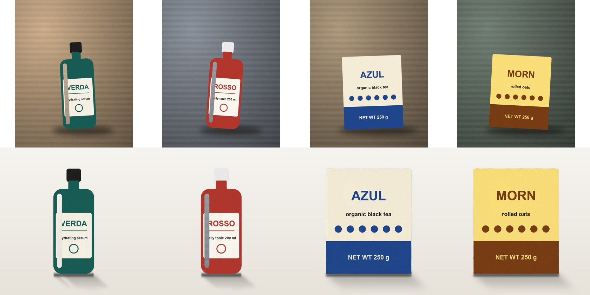

# CatalogSnap AI

Batch pipeline that turns raw phone photos of products into consistent catalog shots: same
canvas, same ground line, same lighting and background, with a synthesized contact shadow.
Every output passes a brand guardrail before it is stored, so a product whose label, logo or
colors drifted never reaches the catalog.

```
raw photo ──> cutout (BiRefNet) ──> scene backend ──> guardrail agent ──> versioned storage
                                     studio | kontext    (LangGraph)       local | S3 / MinIO
```



Top: synthetic "phone photos" from `scripts/make_samples.py`. Bottom: pipeline output with the
`studio` backend.

## How it works

**Cutout** (`cutout.py`). Background removal through `rembg`, BiRefNet by default
(`birefnet-general-lite`; any rembg model name works, including `birefnet-general` and `sam`).
Runs on CPU with ONNX Runtime. Empty or whole-frame masks are rejected as failed jobs.
BiRefNet needs a few GB of free RAM; when the machine cannot provide it, the pipeline falls
back to lighter models (`isnet-general-use`, then `u2netp`) and records which one was used.
Two repairs happen before anything else sees the cutout:

- **Hole repair.** Segmenters sometimes punch out printed dots, highlights or pale label
  areas. An enclosed hole is filled when its color differs from the photo's background, and
  kept when it shows the background through it (a mug handle).
- **Straightening.** A boxy product tilted up to 10 degrees is rotated upright, so every SKU
  sits square on the same ground line.

**Scene backends** (`scene.py`).

| backend | what it does | product pixels |
|---|---|---|
| `studio` (default) | Brand gradient background, two-layer synthesized shadow (tight occlusion + soft cast shadow), product pasted on a fixed ground line. Deterministic, no GPU. | untouched |
| `kontext` | Sends the studio draft to FLUX.1 Kontext (Black Forest Labs API) with a lifestyle-scene prompt. Needs `CATALOGSNAP_BFL_API_KEY`. | regenerated by the model, so guardrailed |

**Brand guardrail agent** (`guardrail/`). A LangGraph state machine:

```
generate -> inspect -+-> accept
    ^                +-> retry     new seed, stricter prompt
    |                +-> fallback  switch to the pixel-exact studio backend
    +----------------+-> reject    stored under rejected/, never under processed/
```

`inspect` registers the candidate back onto the original cutout (SIFT + RANSAC homography) and
measures, inside the product mask only:

| metric | catches | default threshold |
|---|---|---|
| SSIM | redrawn labels, smeared text | >= 0.80 |
| feature inlier ratio | warped logos | >= 45% |
| homography anisotropy | stretched or squashed product | <= 1.08 |
| median CIEDE2000 | color drift | <= 9.0 |
| circular hue shift | brand color changing hue | <= 12 deg |

Routing is a fixed policy rather than an LLM call, so every accept/reject is reproducible
from the metrics in the SKU's report.

**Storage** (`storage.py`). Local filesystem or S3/MinIO with the same key layout. Versions
are explicit in the key, so reprocessing a SKU never overwrites an earlier result:

```
batches/{batch}/{sku}/raw/v0001.jpg
batches/{batch}/{sku}/cutout/v0001.png
batches/{batch}/{sku}/processed/v0001.png
batches/{batch}/{sku}/report/v0001.json
batches/{batch}/{sku}/status.json
```

**Queue and workers** (`jobqueue.py`, `worker.py`). In-process queue for development; Redis
for a cluster. A popped job stays in a processing list until acked, so a pod killed during
scale-down does not lose its job.

## Run it locally

```bash
py -3.11 -m venv .venv
```
```bash
.venv/Scripts/python -m pip install -e ".[dev]"
```
```bash
.venv/Scripts/python scripts/make_samples.py
```
```bash
.venv/Scripts/catalogsnap run samples/raw --out output
```

Results land in `output/catalog/`. The first run downloads the cutout model.

API (single process, no Redis needed):

```bash
.venv/Scripts/catalogsnap serve
```

| endpoint | |
|---|---|
| `POST /batches` | multipart `files`; file name becomes the SKU |
| `GET /batches/{id}` | per-SKU state and metrics |
| `GET /batches/{id}/{sku}/image` | latest accepted catalog image |
| `GET /batches/{id}/{sku}/cutout` | transparent cutout |
| `GET /batches/{id}/{sku}/report` | guardrail metrics for every attempt |

Interactive docs at `http://127.0.0.1:8000/docs`.

## Deploy

`docker compose up --build` starts the API, two workers, Redis and MinIO.
`deploy/k8s/catalogsnap.yaml` has the API and worker Deployments and a worker
HorizontalPodAutoscaler (CPU target 60%, 1 to 12 pods, slow scale-down).

## Tests

```bash
.venv/Scripts/python -m pytest
```

The tests use a stand-in segmenter (no model download), `moto` for S3 and `fakeredis` for the
queue. The guardrail tests tamper with a product (hue shift, blur, stretch) and assert each is
caught, and run the agent against a backend that always drifts to check retry and fallback.

## Status

Exercised on a Windows laptop (CPU only, about 11 s per image, almost all of it BiRefNet):

- cutout, hole repair, straightening, shadow synthesis, studio backend, guardrail, local
  storage and the CLI, end to end on the four sample photos
- the API, S3 storage and Redis queue through the test suite (`moto`, `fakeredis`)

Not yet exercised:

- **`kontext` backend.** Written against the Black Forest Labs API but never called; it needs
  an API key. The guardrail's retry and fallback paths are tested with a simulated drifting
  backend, not with real model output, so the thresholds are untuned for real generations.
- **Docker image, compose stack and Kubernetes manifests.** Written but not built or applied.
- **Real product photos.** The samples are flat synthetic drawings. Real photos with glass,
  reflections or busy backgrounds will stress the cutout model differently.

Known gap: the guardrail compares the output against the cutout, so it cannot notice a
cutout that lost a part of the product at its outer edge (a cap or a cable). Hole repair
covers losses inside the silhouette only.
